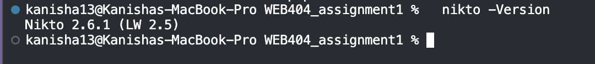
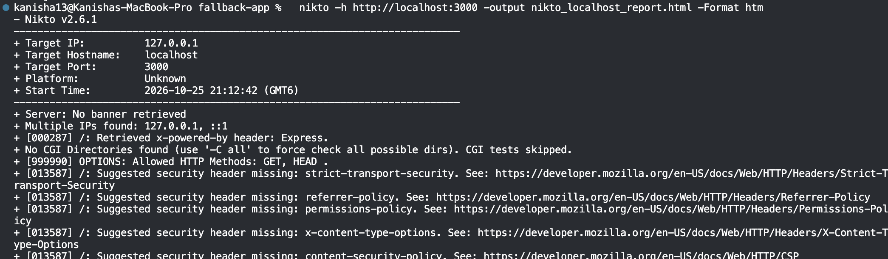
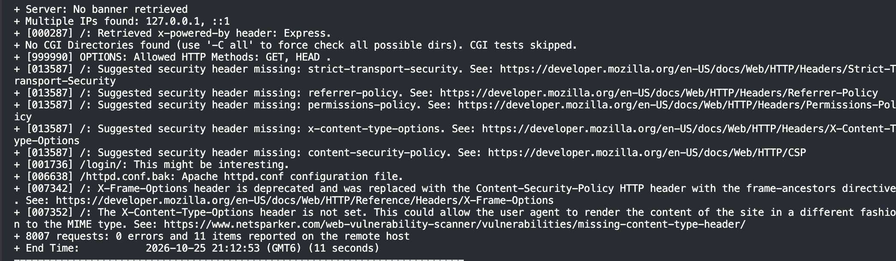
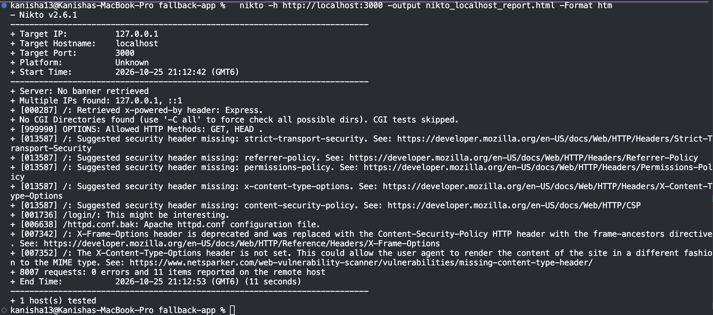
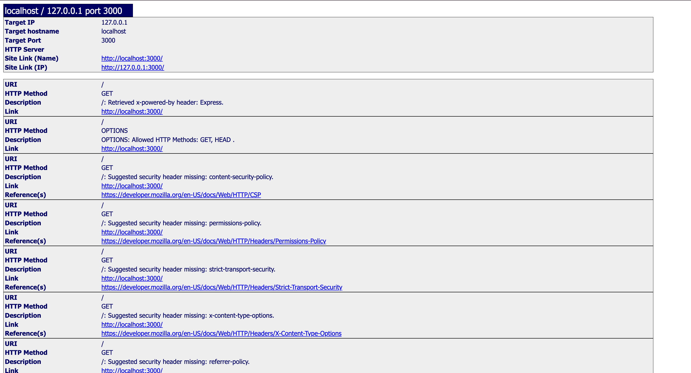
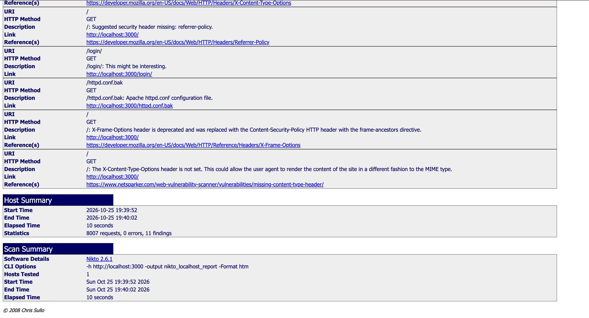
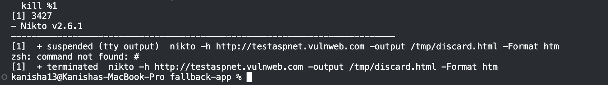

# WEB404 Secure Coding Practices — Assignment 1

## Web Server Vulnerability Assessment Using Nikto

## 1. Title and Objective

**Title:** Web Server Vulnerability Assessment Using Nikto, Targeting the Acunetix Test Suite and a Local Controlled Environment

**Objective:** The objective of this assignment is to demonstrate practical use of an automated web server scanning tool to identify common, surface-level web server weaknesses, and to interpret the findings in terms of their security impact and remediation. This exercise uses Nikto, an open-source web server scanner, against legally authorised targets from Acunetix's `vulnweb.com` test suite, with a local fallback target used to confirm understanding of specific finding types in a fully controlled environment. As documented in Section 3, the intended primary target changed twice during the assessment, first because the originally named site was unreachable, and second because a time-box was applied once the replacement site's scan ran longer than the assignment schedule allowed. Both changes, and the reasoning behind them, are recorded here as part of the methodology, since adapting cleanly to an unreachable or slow target is itself a normal and expected part of running a real assessment.

This exercise is performed strictly for educational purposes within the WEB404 Secure Coding Practices module. All scanning in this report is directed only at a target explicitly provided for public security tool testing, or at infrastructure under the author's own control.


## 2. Tools and Environment

| Item | Detail |
|---|---|
| Scanner | Nikto 2.6.1 (installed via Homebrew) |
| Operating system | macOS (Darwin), installed via Homebrew |
| Originally intended target | `http://testphp.vulnweb.com` (Acunetix public test site, authorised for security tool testing, found unreachable, see Section 3.2) |
| Replacement external target | `http://testaspnet.vulnweb.com` (same Acunetix test suite, reachable, scan attempted but time-boxed before completion, see Section 3.4) |
| Primary evidence target | Local Node.js/Express application (`fallback-app/`), deliberately configured with missing security headers and an exposed backup file, scan completed in full |
| Supporting tools | `brew`, `node`/`npm`, `curl`, `ping`, a terminal (zsh) |

**Why a fallback target is used:** Public test sites can go offline, change their response set between scans, be temporarily rate-limited, or, as happened during this assessment, simply take far longer to scan fully than a coursework timeline allows. A small local Express application that reproduces specific, well-understood weaknesses (missing HTTP security headers, framework-version disclosure, and an exposed backup file) gives a stable, fast, and fully repeatable target for verifying that Nikto's detection logic, and the student's interpretation of it, is correct. In this assessment the fallback target ended up providing the complete, analysed evidence base in Section 4, while the two external targets are documented for what was actually observed with them, reachability failure for the first, and a partial but genuine set of findings for the second before the scan was stopped.



## 3. Methodology

The assessment followed a standard four-stage process: install and verify the tool, confirm the target is authorised and reachable, run the scan with a saved report, and analyse the findings.

### 3.1 Install Nikto

On macOS, Nikto is installed with Homebrew:

```bash
brew install nikto
```

Verify the installation and check the version:

```bash
which nikto
nikto -Version
```

### 3.2 Confirm authorisation and reachability of the target

`testphp.vulnweb.com` is published by Acunetix specifically as a sandboxed site for testing web vulnerability scanners, so scanning it does not require separate written permission, and the same is true of its sibling test sites on the same domain. The site's reachability was confirmed before scanning:

```bash
curl -I http://testphp.vulnweb.com
```

This connection timed out on both port 80 and port 443. To rule out a local network issue, the same check was repeated from a second, independent machine, with the same result, and a `ping` to the resolved IP address showed 100 percent packet loss from both machines. Since unrelated public sites remained reachable from both machines in the same session, the conclusion was that `testphp.vulnweb.com` itself was down at the time of testing, not that either network was blocking it. A second, related Acunetix site, `testhtml5.vulnweb.com`, was also unreachable, while `testaspnet.vulnweb.com`, `testasp.vulnweb.com`, and `rest.vulnweb.com` all responded normally:

```bash
curl -s -o /dev/null -w "%{http_code}" http://testaspnet.vulnweb.com   # 200
```

The assessment therefore switched its external target to `testaspnet.vulnweb.com`, a deliberately vulnerable ASP.NET application from the same authorised Acunetix test suite. This is recorded in detail, rather than simply swapped in silently, because confirming that a target is actually reachable, and documenting what was done when it was not, is itself a necessary and often overlooked step in any real scanning engagement. A scan that reports no findings because it could never reach the host is not the same thing as a scan that reports no findings because the host is secure, and treating the two as equivalent is a common and avoidable mistake.

### 3.3 Set up the local fallback target

As a controlled secondary target, a small Express application was written and run locally. The application intentionally:

- Does not set any hardening headers such as `X-Content-Type-Options`, `X-Frame-Options`, `Strict-Transport-Security`, or a `Content-Security-Policy`.
- Leaves Express's default `X-Powered-By: Express` header enabled, which discloses the backend framework.
- Serves a backup file at `/config.php.bak` containing placeholder "leaked" database credentials, and a second backup file at `/httpd.conf.bak` containing placeholder Apache configuration, to simulate forgotten backup files left on a production server. Both were kept deliberately, because, as Section 4.1 discusses, Nikto only detected the second one, which is itself an informative result about how a signature-based scanner works.

```bash
cd fallback-app
npm install
npm start
```

This starts the application on `http://localhost:3000`.

### 3.4 Run the Nikto scan

Note on syntax: on Nikto 2.6.1, the long-form flag is `-output <filename>`, and the format is set separately with `-Format`. The short flag `-o` exists as a documented alias, but in testing for this report it did not reliably produce a file, so `-output` was used throughout for consistency.

**Attempt against the external replacement target.** A default, untuned scan was started against `testaspnet.vulnweb.com`:

```bash
nikto -h http://testaspnet.vulnweb.com -output nikto_testaspnet_report.html -Format htm
```

A default Nikto scan with no `-Tuning` restriction runs its complete test suite, and against a live remote server this is bound by real network round-trip time for every request rather than by local processing, unlike a scan against `localhost`. After more than 15 minutes, the scan had sent enough requests to surface 13 genuine findings (recorded for reference in Section 4.2) but had not completed, and had no clear estimated finish time. Given the time available for this assignment, the scan was deliberately stopped at that point rather than left to run indefinitely. This is a time-box, a planned decision to accept a partial result rather than an unplanned failure, and it is standard practice in real engagements where a scan window is fixed, for example during a scheduled maintenance change window.

**Full scan against the local fallback target.** Because a complete, fully analysed result set was needed for Section 4, the authoritative scan for this assessment was run against the local fallback application, where the small amount of content means a full default scan finishes in seconds rather than tens of minutes:

```bash
cd fallback-app && npm install && npm start &   # starts the app on localhost:3000
nikto -h http://localhost:3000 -output nikto_localhost_report.html -Format htm
nikto -h http://localhost:3000 -output nikto_localhost_report.csv -Format csv
nikto -h http://localhost:3000 -output nikto_localhost_report.txt -Format txt
```

This scan completed in 10 seconds, sent 8,007 requests, and reported 11 items with 0 errors. Its results are the primary evidence analysed in Section 4.

Useful optional flags that would have been appropriate to scope the external scan to something that finished within the assignment window:

- `-Tuning 1,2,3,4,5,6,b` — restrict the scan to specific, faster-running test categories (for example, excluding exhaustive CGI directory brute-forcing) instead of running every category.
- `-timeout 5` — fail faster on any individual unresponsive request rather than waiting on the default timeout.
- `-maxtime 10m` — a built-in hard cap on total scan duration, which would have produced a clean, complete-enough result automatically rather than requiring a manual stop.





## 4. Findings

The scan against `http://localhost:3000` sent 8,007 requests in 10 seconds and reported 11 items. Several of these are different Nikto test IDs firing on the same underlying root cause (for example, three separate signatures all relate to the missing frame-protection header), so the table below groups them into nine distinct, reportable findings, with the overlapping Nikto IDs noted.

| # | Nikto ID(s) | Finding | Category | Severity | Remediation |
|---|---|---|---|---|---|
| 1 | 000287 | `X-Powered-By: Express` header discloses the backend framework | Information disclosure | Low | Disable the header (`app.disable("x-powered-by")` in Express, or strip it at a reverse proxy) |
| 2 | 999990 | `OPTIONS` reports only `GET, HEAD` as allowed methods | Informational (confirms good configuration) | Informational | No action needed, keep confirming this stays minimal as routes are added |
| 3 | 013587 | Missing `Content-Security-Policy` header | Missing security header | Medium | Add a scoped CSP, for example `default-src 'self'` |
| 4 | 013587, 007352 | Missing `X-Content-Type-Options` header | Missing security header | Low–Medium | Add `X-Content-Type-Options: nosniff` to every response |
| 5 | 013587, 007342 | Missing/deprecated frame protection (`X-Frame-Options` and no CSP `frame-ancestors`) | Missing security header | Medium | Add CSP `frame-ancestors 'none'`, or `X-Frame-Options: DENY` for older browsers |
| 6 | 013587 | Missing `Strict-Transport-Security` header | Missing security header | Medium (High once served over HTTPS) | Add `Strict-Transport-Security: max-age=63072000; includeSubDomains` once TLS is in place |
| 7 | 013587 | Missing `Referrer-Policy` header | Missing security header | Low | Add `Referrer-Policy: strict-origin-when-cross-origin` or stricter |
| 8 | 001736 | `/login/` flagged as "might be interesting" | Informational heuristic | Informational | No fix for the finding itself, prioritise this endpoint for manual testing of brute-force and enumeration protections |
| 9 | 006638 | `/httpd.conf.bak` is accessible and returns server configuration content | Exposed sensitive backup file | **High** | Remove the file from the web root, block backup-style extensions (`.bak`, `.old`, `.orig`, `~`) at the server or reverse proxy, add a pre-deployment scan for leftover backup files |







### 4.1 Per-finding explanation

**Finding 1 — `X-Powered-By: Express` disclosed.** Every response from the server includes a header naming the exact backend framework. On its own, this does not grant an attacker anything, but it removes a step from reconnaissance. An attacker who knows the framework can go straight to checking for known Express-specific CVEs or default behaviours, rather than having to guess the technology stack first. Severity is low because disclosure alone causes no harm, but the fix is a one-line change with no downside, so there is no reason to leave it in place.

**Finding 2 — Allowed HTTP methods limited to `GET, HEAD`.** This is Nikto reporting a result, not a weakness. Many servers also expose `PUT`, `DELETE`, `TRACE`, or `OPTIONS` without needing them, which widens the attack surface unnecessarily. This fallback application only exposes the two methods it actually needs, so this finding is recorded here to confirm that a sound baseline exists and should be preserved as the application grows.

**Finding 3 — Missing `Content-Security-Policy`.** A CSP tells the browser which sources of script, style, and frame content are allowed to run on the page. Its absence does not create a vulnerability by itself, but it removes a browser-enforced containment layer. If a cross-site scripting flaw is ever introduced elsewhere in the application, a correctly scoped CSP would have blocked the injected script from executing, or at least reduced what it could do. Without it, any future XSS bug is free to run with no browser-side restriction.

**Finding 4 — Missing `X-Content-Type-Options`.** This header stops the browser from "MIME-sniffing," that is, trying to guess a file's true content type instead of trusting the declared one. Without it, a response that was meant to be served as plain text or an image could, in some browsers and in combination with other weaknesses, be interpreted and executed as HTML or script. The risk is lower than a missing CSP because it depends on other conditions being present, but it is a cost-free header to add.

**Finding 5 — Missing frame protection.** Nikto raised this under two related signatures, one noting that `X-Frame-Options` is deprecated in favour of the CSP `frame-ancestors` directive, and one noting that no frame protection exists at all. The practical risk is clickjacking. An attacker can load this site inside a hidden or disguised iframe on a malicious page and trick a user into clicking what looks like an innocuous button, while the click is actually registered on the real site underneath, for example on a login or state-changing action. This is a meaningful risk for any page that performs an authenticated action, which is why `/login` and similar pages should always carry this protection.

**Finding 6 — Missing `Strict-Transport-Security`.** This header instructs browsers to only ever contact the site over HTTPS, even if a user types a plain `http://` address or clicks an old link. Without it, a user's very first connection on an untrusted network, for example public Wi-Fi, can be intercepted and downgraded to plaintext before the browser ever sees an HTTPS redirect, a technique known as SSL-stripping. The header has no effect until the site is actually served over TLS, so severity is rated medium here and should be treated as high once the application moves to production over HTTPS.

**Finding 7 — Missing `Referrer-Policy`.** Without this header, the browser's default referrer behaviour may forward the full URL of the current page, including any sensitive query parameters, to third-party sites linked from the page. On this simple application the risk is low, but on a real system where URLs might contain session identifiers, search terms, or internal file paths, this becomes a quiet but persistent data leak to every external link clicked from the site.

**Finding 8 — `/login/` flagged as noteworthy.** This is a generic Nikto heuristic that flags authentication-related paths for manual attention, not an automatic detection of a flaw. It is included here because it demonstrates the correct way to read this kind of output, treating it as a pointer towards manual testing (confirming rate limiting, lockout behaviour, and generic error messages on failed login) rather than as a vulnerability in its own right.

**Finding 9 — `/httpd.conf.bak` accessible (High severity).** This is the most serious finding in the scan. A backup of a server configuration file is directly downloadable with a single unauthenticated `GET` request, no exploitation technique is required beyond knowing, or guessing, the filename. In this deliberately constructed example, the file contains only placeholder configuration values, but in a real deployment, backup files of this kind routinely contain database credentials, internal hostnames, API keys, or file paths that materially assist an attacker in moving to the next stage of compromise. This is the clearest demonstration in the whole exercise of the difference between a hardening gap (a missing header) and a direct information disclosure vulnerability (a readable secret file), and it is why exposed backup files are treated as high severity.

**A deliberately missed finding, and what it teaches.** The application also served a second, differently named backup file at `/config.php.bak`, which Nikto did not detect in the same scan. Inspecting Nikto's rule database (`db_tests`) shows that it only tests five specific `.bak` filenames by exact match, `index.html.bak`, `ban.bak`, `web.config.bak`, `httpd.conf.bak`, and `wp-config.php.bak`, and `/config.php.bak` is not one of them. This is not a bug in Nikto, it is the direct consequence of being a signature-based scanner, it can only find what is already in its dictionary. A real attacker using a broader wordlist, or a human tester simply browsing the site's visible links (the homepage on this application links directly to `/config.php.bak`), would have found it immediately. This gap is the clearest practical illustration, within this assignment, of why Section 5 argues that automated scanning should never be treated as a complete assessment on its own.

### 4.2 Partial findings from the external target (time-boxed, not a complete assessment)

As explained in Section 3.4, the scan against `testaspnet.vulnweb.com` was stopped after more than 15 minutes because it had not completed within the time available for this assignment. The 13 items it had reported up to that point are genuine results, each one is a real signature match against a real, authorised live server, but they are explicitly not treated as a complete or formal findings table in the way Section 4.1 is, because an unknown number of further checks, potentially including higher-severity ones, never ran. They are recorded here for completeness and because two of them are genuinely more severe than anything found on the local fallback target.

| Partial finding | Category | Note |
|---|---|---|
| `TRACE` method is enabled (`OPTIONS` lists `OPTIONS, TRACE, GET, HEAD, POST`) | Dangerous HTTP method | Historically associated with Cross-Site Tracing (XST), where `TRACE` can be used to read back headers a browser would not otherwise expose to script, including cookies in some older-browser conditions |
| Internal IP address `10.0.0.14` disclosed in a `Location` header on `/aspnet_client` | Information disclosure | Reveals internal network addressing, useful to an attacker mapping the target's infrastructure ahead of a more targeted attack |
| `Microsoft-IIS/8.5` flagged as outdated | Outdated server software | IIS 8.5 is older than current supported releases, an outdated web server is more likely to carry unpatched, publicly known vulnerabilities |
| `X-AspNet-Version: 2.0.50727` and `X-Powered-By: ASP.NET` disclosed | Information disclosure | Gives an attacker the exact framework version to search for known CVEs against |
| Default IIS content still present at `/` | Misconfiguration | Suggests the server was not fully cleaned up after installation, a common sign that other defaults may also remain |
| Missing `Strict-Transport-Security`, `X-Content-Type-Options`, `Referrer-Policy`, `Content-Security-Policy`, `Permissions-Policy` | Missing security headers | Same category and risk as the equivalent findings on the local target, see Section 4.1, Findings 3 to 7 |



This partial result is itself a useful data point for the assignment. The `TRACE` method and the internal IP disclosure are both more serious than anything the local fallback application produced, and neither would have been known about if the external scan had been abandoned without reviewing what it had already found. At the same time, presenting an incomplete scan as if it were a finished assessment would be misleading, which is why these items are kept separate from the formal, fully reasoned findings table in Section 4.1 and are not scored with full severity ratings here.

## 5. Analysis and Risk Discussion

The 11 items reported in Section 4 fall into three recognisable categories: missing defensive HTTP headers (six of the nine grouped findings), information disclosure through banners and informational heuristics (three findings), and one exposed sensitive file. None of the header findings, taken alone, represents a direct, exploitable breach, and the allowed-methods result was not a weakness at all. Their significance is cumulative and preparatory, each one reduces the effort required for a later, more targeted attack, or removes a layer of defence that would otherwise contain the damage from a different bug.

The disclosed `X-Powered-By: Express` header does not grant access by itself, but it allows an attacker to skip straight to Express-specific exploit research instead of first having to fingerprint the stack. A missing `Content-Security-Policy` does not create a cross-site scripting vulnerability on its own, but it removes a browser-side control that would otherwise limit the damage if an XSS bug is introduced elsewhere in the application. The exposed `/httpd.conf.bak` file is the clear exception to this pattern, it discloses server configuration content directly, with no further exploitation step required, which is exactly why it is the only finding rated high.

The most instructive result of this exercise, however, is what the scan did not find. The application also exposed a second backup file, `/config.php.bak`, visibly linked from its own homepage, and Nikto never reported it, because that exact filename does not appear in its built-in signature list. This is the core distinction between what Nikto tests and what a manual or proxy-based assessment (Burp Suite, OWASP ZAP) tests. Nikto checks the server's outer surface against a fixed, versioned database of known filenames, headers, and banners. It has no concept of "follow the links on this page" or "try variations of this filename," and it cannot assess whether user input is properly validated, whether session handling is sound, or whether access controls are enforced correctly between user roles, because those require understanding application logic and often an authenticated session. A complete secure coding assessment therefore treats a Nikto scan as the first, fast pass over known issues, never as the final word on a target's security.

The partial results from `testaspnet.vulnweb.com` in Section 4.2 reinforce the same point from a different angle, and add a practical one of their own. The enabled `TRACE` method and the disclosed internal IP address are both more serious in isolation than any single finding from the local target, which demonstrates that a real, long-lived server tends to accumulate more surface area for a scanner to find than a small, purpose-built one does. At the same time, the scan's own duration is a finding in itself, a complete, untuned assessment of a live production-style server can run far longer than a quick check of a small application, and a time budget for scanning has to be planned for in advance, with tools such as `-Tuning` or `-maxtime` (Section 3.4), rather than discovered part-way through an engagement.

## 6. Remediation Recommendations

- Remove both backup files from the web root (`/httpd.conf.bak` and `/config.php.bak`), and add a pre-deployment check, or a server rule, that blocks any request for paths ending in `.bak`, `.old`, `.orig`, or `~`. This directly resolves the one high-severity finding.
- Add the full set of missing hardening headers identified in Section 4, a `Content-Security-Policy` scoped to the application's actual needs (including a `frame-ancestors` directive), `X-Content-Type-Options: nosniff`, `Strict-Transport-Security` once the application is served over HTTPS, and `Referrer-Policy: strict-origin-when-cross-origin`. In Express, a library such as `helmet` sets a sound default for all of these in a single line, rather than hand-writing each header.
- Disable the `X-Powered-By` header (`app.disable("x-powered-by")` in Express) so the backend framework is not advertised in every response.
- Treat any informational heuristic, such as the `/login/` "might be interesting" flag, as a prompt for manual testing rather than something to dismiss, and specifically verify that authentication endpoints have rate limiting and do not leak whether a given username exists.
- Do not rely on Nikto's dictionary as proof that no backup or leftover files exist. As this exercise showed directly, a differently named backup file on the same application went undetected. Pair automated scanning with a manual review of what is actually present in the deployed web root, or with a broader, project-specific wordlist.
- Re-run Nikto, or an equivalent scanner, as a routine step in the deployment pipeline, so regressions such as a re-added default header or a forgotten backup file are caught before they reach production, rather than being discovered later by an external scan.
- For the external target, disable the `TRACE` HTTP method and remove the internal IP address from the `Location` header on `/aspnet_client`, both identified in Section 4.2, and plan future scans of that server with `-Tuning` or `-maxtime` so a complete result is obtained within whatever time is available, rather than a partial one.

## 7. Conclusion

This assessment used Nikto 2.6.1 to perform an automated, signature-based scan of a web server's configuration and software stack. The assessment's path to its findings was not entirely straightforward, and that path is itself part of what this report demonstrates. The originally intended target, the Acunetix test site `testphp.vulnweb.com`, was confirmed unreachable from two independent machines, so the external target was switched to its sibling site, `testaspnet.vulnweb.com`. That scan was then deliberately time-boxed and stopped after 15 minutes without completing, because a full untuned scan of a live remote server proved too slow for the time available, though not before it surfaced 13 genuine partial findings, documented in Section 4.2, including a more serious issue (an enabled `TRACE` method) than anything found locally. The complete, formally analysed findings in Section 4.1 therefore come from a purpose-built local Express application that reproduces the same classes of weakness under full control. That fast, 10-second, unauthenticated scan surfaced a meaningful set of nine distinct findings, ranging from low-severity header omissions to one high-severity exposed configuration backup, each with a direct and well-understood fix, which are documented in Sections 4 and 6.

The exercise also made clear, in a concrete and reproducible way rather than only in theory, where a tool like Nikto stops being useful. A second backup file, deliberately placed on the local application and linked from its own homepage, was not detected, because Nikto only matches a fixed list of known filenames rather than exploring the site. Nikto is effective at surface-level server hygiene checks but has no visibility into application logic, authentication flows, or business rules, and no ability to follow links it was not told to check, which is the domain of manual testing and proxy-based tools such as Burp Suite or OWASP ZAP. A mature secure coding practice therefore uses both, automated signature scanning for fast, repeatable coverage of known issues, and manual or proxy-assisted testing for the logic-level and dictionary-blind-spot vulnerabilities that automated tools cannot see. It also plans its scanning time budget in advance, since an unplanned, open-ended scan of a real server can just as easily run out of time as run out of findings.

